<h1 align="center">¡Hola! 👋 Soy Steven Alfonso</h1>

  Estudiante de <b>Estadística</b> en la <b>Universidad Nacional de Colombia</b> 📊 🇨🇴 
  Me interesan la inteligencia artificial, el análisis de datos y los modelos de pronóstico.

---

## 🧑‍🎓 Sobre mí

- 🎓 Estudio Estadística en la Universidad Nacional de Colombia.
- 🤖 Me interesa mucho la inteligencia artificial.
- 📈 Me apasiona convertir datos en decisiones.
- 🤝 Abierto a colaborar en proyectos de análisis de datos, estadística aplicada y visualización.
- 📫 Contacto: stalfonsog@gmail.com

## 🛠️ Herramientas

  
  
  
  
  
  
  

**Áreas:** inteligencia artificial · aprendizaje automático · series de tiempo · regresión · inferencia estadística · minería de datos · visualización

## 🚀 Proyectos

| Proyecto | Descripción |
|---|---|
| 📉 **Pronósticos COLCAP** | Modelado y pronóstico del índice bursátil COLCAP con técnicas de series de tiempo (2026). |
| ⛏️ [**Minería de datos**](https://github.com/StalfonsoG/dm_2016325_2026_2) | Trabajos y laboratorios del curso de minería de datos (2026-2). |
| 🧩 [**WordLink Match & Learn**](https://github.com/EdwardVE/WordLink-Match-Learn) | Proyecto colaborativo de aprendizaje con juego de emparejar palabras. |
| 🏗️ [**Ingeniería de Software 1**](https://github.com/Juan-Vergara/Repositorio-grupal---Ingenier-a-de-Software-1---2024-2-Grupo-11) | Proyecto grupal del curso de Ingeniería de Software (2024-2). |

## 📊 Estadísticas

  
  

## 👾 Mis contribuciones

## 👾 Mis contribuciones

  

---

<i>"Sin datos, solo eres otra persona con una opinión." — W. Edwards Deming</i>

